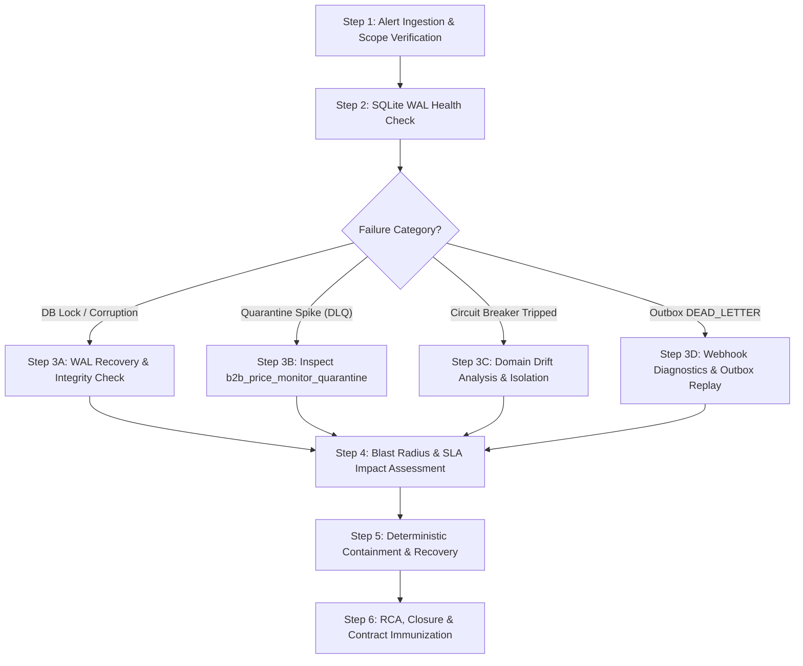

# Deterministic Incident Response Runbook — B2B Price & Market Monitor (`INCIDENT_TEMPLATE.md`)

This runbook defines the mandatory deterministic triage, containment, and recovery protocols for Profile 1: Lean App/CDC (`b2b_price_monitor_v1`). It is the operational guide for engineering and DataOps when diagnosing SQLite WAL storage degradation, Dead Letter Queue (`b2b_price_monitor_quarantine`) anomalies, Domain Circuit Breaker activations (`TEMPLATE_DRIFT_DETECTED`), or Transactional Outbox (`price_change_outbox`) delivery failures.

- **MANDATE**: Execute the 6 steps of the Deterministic Decision Tree below sequentially before attempting manual interventions.
- **!ANTI_PATTERN**: Never manually delete rows from `b2b_price_monitor` or edit the database file with external tools while scraper processes are running; always use `sqlite3` CLI with `PRAGMA busy_timeout = 5000` or the provided CLI commands.

---

## 1. Data Incident Severity Matrix (P0 – P3)

| Severity | Classification Criteria | Triage SLA | Autonomous Action Allowed (`ALWAYS DO`) | Human Gate (`ASK FIRST`) |
| :--- | :--- | :--- | :--- | :--- |
| **P0 (Critical)** | SQLite file corruption (`PRAGMA integrity_check` fails); persistent database locking halting all runs; silent alert corruption (e.g., negative price, corrupted `entity_key` collision). | < 15 min | Pause scraper crons; checkpoint WAL (`PRAGMA wal_checkpoint(TRUNCATE)`); capture diagnostic copy of `./b2b_monitor.db`. | Database file restore from backup; table re-creation; customer-facing alert retraction. |
| **P1 (High)** | Domain Circuit Breaker tripped (`TEMPLATE_DRIFT_DETECTED`, > 20% quarantine rate on domain), halting alerts for client catalog; outbox terminal failure spike (`DEAD_LETTER` count > 5). | < 30 min | Verify quarantined payloads in `b2b_price_monitor_quarantine`; inspect target site HTML selectors; confirm alerts are safely isolated in `CIRCUIT_HALTED`. | Deploying modified scraper selector rules to production; bulk replaying dead-lettered notifications. |
| **P2 (Medium)** | Isolated extraction failure (< 20% domain failure rate) diverted to quarantine; transient webhook dispatch failure (HTTP 429 rate limit or HTTP 5xx) with retries pending (`retry_count < 5`). | < 4 hours | Inspect quarantined snippet; check webhook endpoint status; verify backoff and jitter timing on outbox retries. | Adjusting domain circuit breaker thresholds or modifying scraper timeout configurations. |
| **P3 (Low)** | Freshness delay within SLA boundary (< 60 min); minor selector deprecation warnings; outbox table vacuum or 30-day retention cleanup. | < 24 hours | Run `purge_dispatched_outbox(conn, retention_days=30)` and `checkpoint_and_vacuum(conn)` during off-peak window. | N/A |

---

## 2. Deterministic 6-Step Decision Tree



---

## 3. Diagnostic & Remediation Protocols

### Step 1 — Alert Ingestion & Scope Verification
1. Identify the failing domain (`domain`), entity (`entity_key`), outbox event (`outbox_id`), or quarantine record (`quarantine_id`).
2. Verify environment paths: default DB path is resolved via `B2B_DB_PATH` or `./b2b_monitor.db`.
3. Assign severity (`P0` through `P3`) using the matrix above.

### Step 2 — SQLite WAL Health & Storage Diagnostics
Run read-only integrity PRAGMAs to rule out underlying SQLite corruption or lock starvation:
```bash
sqlite3 ./b2b_monitor.db "PRAGMA busy_timeout = 5000; PRAGMA integrity_check;"
sqlite3 ./b2b_monitor.db "PRAGMA journal_mode; PRAGMA synchronous;"
```
- **If `integrity_check` returns `ok`**: Storage layer is intact. Proceed to Step 3.
- **If `integrity_check` reports errors**: Immediately execute **Protocol 3A (Storage Recovery)**.
- **If `database is locked` error occurs**: Check for dangling processes holding a write lock (`fuser ./b2b_monitor.db` or `lsof ./b2b_monitor.db`). Ensure all connections use `timeout >= 5000` and short-lived `BEGIN IMMEDIATE` transactions.

---

### Step 3A — Protocol: SQLite WAL Recovery
1. Checkpoint the WAL file to commit pending journal pages to the main database:
   ```bash
   sqlite3 ./b2b_monitor.db "PRAGMA wal_checkpoint(TRUNCATE);"
   ```
2. Check disk space and permissions on `./b2b_monitor.db`, `./b2b_monitor.db-wal`, and `./b2b_monitor.db-shm`.
3. If corruption is unrecoverable, restore from the latest verified daily backup and replay completed scrape batches.

---

### Step 3B — Protocol: `b2b_price_monitor_quarantine` DLQ Triage
Inspect the Dead Letter Queue table to identify failing selectors, schema violations, or bot challenges:
```sql
-- 1. Summarize unresolved quarantine records by failure reason
SELECT failure_reason, COUNT(*) AS failure_count
FROM b2b_price_monitor_quarantine
WHERE resolution_status = 'UNRESOLVED'
GROUP BY failure_reason
ORDER BY failure_count DESC;

-- 2. Inspect the latest 5 quarantined payloads
SELECT quarantine_id, domain, raw_url, failure_reason, quarantined_at,
       SUBSTR(raw_payload, 1, 200) AS payload_preview
FROM b2b_price_monitor_quarantine
WHERE resolution_status = 'UNRESOLVED'
ORDER BY quarantined_at DESC
LIMIT 5;
```

**Common Failure Reason Codes & Remedies:**
- `TEMPLATE_DRIFT_MISSING_PRICE`: Competitor altered HTML structure or selector. Update CSS selector in scraper configuration.
- `INVALID_CURRENCY`: Extracted currency code is missing or not a 3-letter ISO code. Validate source currency normalization.
- `PARSE_EXCEPTION`: Target page returned non-HTML payload (e.g. JSON error, empty body, or HTTP error page).
- `ANTI_BOT_CHALLENGE`: Target site served CAPTCHA or Cloudflare challenge. Review request headers, TLS impersonation, or request rate.

Once fixed, mark resolved records:
```sql
UPDATE b2b_price_monitor_quarantine
SET resolution_status = 'RESOLVED'
WHERE domain = :target_domain AND failure_reason = :fixed_reason;
```

---

### Step 3C — Protocol: Domain Circuit Breaker Recovery (`TEMPLATE_DRIFT_DETECTED`)
The Domain Circuit Breaker trips when more than 20% of catalog items for a given domain fail during a scrape batch (with `min_sample_size >= 10`).

1. **Verify Isolation**: Confirm that customer-facing alerts for the affected domain were halted:
   ```sql
   SELECT COUNT(*) AS halted_events
   FROM price_change_outbox
   WHERE notification_status = 'CIRCUIT_HALTED';
   ```
2. **Inspect Administrative Alert**: Check administrative alert logs / webhook channel for `TEMPLATE_DRIFT_DETECTED` with failure rate and domain telemetry.
3. **Selector Remediation**:
   - Retrieve a sample raw URL from quarantine.
   - Fetch the live page and determine updated CSS/XPath selectors.
   - Update extraction logic in the scraper and test against 5 sample URLs in a temporary harness.
4. **Halted Alert Recovery**:
   Once the scraper extraction is verified:
   ```sql
   -- Release halted outbox events back to PENDING for dispatch
   UPDATE price_change_outbox
   SET notification_status = 'PENDING',
       retry_count = 0,
       last_notification_error = NULL,
       updated_at = CURRENT_TIMESTAMP
   WHERE notification_status = 'CIRCUIT_HALTED'
     AND entity_key IN (SELECT entity_key FROM b2b_price_monitor WHERE domain = :target_domain);

   -- Update state table notification status
   UPDATE b2b_price_monitor
   SET notification_status = 'PENDING',
       retry_count = 0,
       last_notification_error = NULL
   WHERE domain = :target_domain
     AND notification_status = 'CIRCUIT_HALTED';
   ```

---

### Step 3D — Protocol: `price_change_outbox` DEAD_LETTER Replay
When a webhook notification fails 5 consecutive times, it transitions to `DEAD_LETTER`.

1. **Diagnose Outbox Failure Reason**:
   ```sql
   SELECT outbox_id, entity_key, event_type, retry_count, last_notification_error, updated_at
   FROM price_change_outbox
   WHERE notification_status = 'DEAD_LETTER'
   ORDER BY updated_at DESC
   LIMIT 10;
   ```
2. **Analyze Root Cause**:
   - `HTTP 429 Too Many Requests`: Webhook endpoint is rate-limited. Verify backoff logic and dispatcher interval.
   - `HTTP 404 / 401 / 403`: Webhook token expired or URL invalid. Verify `B2B_WEBHOOK_URL` in environment / `.env`.
   - `ConnectTimeout / ReadTimeout`: Webhook service experiencing downtime.
3. **Replay Re-Queuing**:
   After endpoint connectivity is restored:
   ```sql
   -- Re-queue dead-lettered events with reset retry counters
   UPDATE price_change_outbox
   SET notification_status = 'PENDING',
       retry_count = 0,
       last_notification_error = NULL,
       updated_at = CURRENT_TIMESTAMP
   WHERE notification_status = 'DEAD_LETTER';

   UPDATE b2b_price_monitor
   SET notification_status = 'PENDING',
       retry_count = 0,
       last_notification_error = NULL
   WHERE notification_status = 'DEAD_LETTER';
   ```
4. Trigger dispatcher run:
   ```bash
   python -m src.main dispatch --db-path ./b2b_monitor.db
   ```

---

### Step 4 — Contract Invariant & Financial Parity Verification
Verify that the core ODCS v3.2.0 contract quality invariants remain 100% green:
```sql
-- 1. Entity key uniqueness (one row per SKU/product)
SELECT COUNT(*) AS total_rows, COUNT(DISTINCT entity_key) AS distinct_keys
FROM b2b_price_monitor;

-- 2. Cents-to-Decimal parity (zero float drift)
SELECT COUNT(*) AS parity_mismatches
FROM b2b_price_monitor
WHERE CAST(ROUND(CAST(current_price AS REAL) * 100, 0) AS BIGINT) <> current_price_cents;

-- 3. Non-negative prices
SELECT COUNT(*) AS negative_prices
FROM b2b_price_monitor
WHERE current_price_cents < 0;

-- 4. Valid closed domains
SELECT COUNT(*) AS invalid_availability
FROM b2b_price_monitor
WHERE availability_status NOT IN ('IN_STOCK', 'OUT_OF_STOCK', 'DISCONTINUED', 'BACKORDER');

SELECT COUNT(*) AS invalid_outbox_status
FROM b2b_price_monitor
WHERE notification_status NOT IN ('PENDING', 'DISPATCHED', 'FAILED', 'DEAD_LETTER', 'CIRCUIT_HALTED');
```

---

### Step 5 — Housekeeping & Retention Maintenance
Dispatched outbox records older than the 30-day operational retention SLA must be purged periodically:
```sql
-- Count dispatched records eligible for 30-day purge
SELECT COUNT(*) AS purgeable_records
FROM price_change_outbox
WHERE notification_status = 'DISPATCHED'
  AND updated_at < DATETIME('now', '-30 days');

-- Execute purge
DELETE FROM price_change_outbox
WHERE notification_status = 'DISPATCHED'
  AND updated_at < DATETIME('now', '-30 days');

-- Reclaim space and truncate WAL
PRAGMA wal_checkpoint(TRUNCATE);
VACUUM;
```

---

### Step 6 — Closure, RCA & Contract Immunization
1. Complete the Post-Mortem Incident Record below.
2. If the incident was triggered by a newly observed competitor edge case (e.g. negative price promotion, zero-division in percentage, new currency), codify it as:
   - A Pydantic validator in `src/models.py`.
   - A verified statement or SQL check in `contracts/b2b_price_monitor_v1.odcs.yaml`.
   - A semantic rule in `knowledge/domain/semantic_rules.md`.

---

## 4. Standardized Post-Mortem Incident Record Template

```markdown
## Incident Report: [INC-YYYY-MM-DD-XXX] — <Short Title>
- **Severity**: P0 | P1 | P2 | P3
- **Affected Contract / Asset**: `urn:datacontract:b2b-price-monitor:b2b_price_monitor_v1`
- **Detection Source**: Quarantine Spike | Circuit Breaker Webhook | SQLite Error | Outbox Dead-Letter
- **Time Window (UTC)**: Start `YYYY-MM-DDTHH:MM:SSZ` — Resolved `YYYY-MM-DDTHH:MM:SSZ`
- **Impacted Domain(s)**: [e.g. competitor-a.com.br]
- **Affected SKU Count**: [e.g. 42 SKUs]

### Root Cause Analysis (Deterministic 5 Whys)
1. **Trigger**: ...
2. **Root Cause**: ...
3. **Why Quarantine / Circuit Breaker Caught / Missed It**: ...

### Remediation & Permanent Guardrails Added
- **Containment Action Executed**: ...
- **Scraper / Selector Hotfix**: ...
- **Contract / Quality Rule Update (`contracts/b2b_price_monitor_v1.odcs.yaml`)**: ...
- **Knowledge / Semantic Rules Update (`knowledge/domain/semantic_rules.md`)**: ...
```
